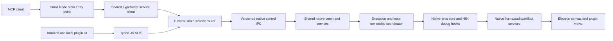

# Plan: preserve ares-64 debugging and MCP in the Electron workbench

Implementation order and task-sized kickoff guidance: [EXECUTION-ROADMAP.md](EXECUTION-ROADMAP.md).

Status: source audit and proposed migration, 2026-10-17. No fork code has been
ported or executed as part of this audit. Complements [PLUGIN-PLAN.md](PLUGIN-PLAN.md)
and changes its delivery order: MCP preservation is an early milestone, not a
future add-on after the plugin UI is finished.

Architecture decision: implement MCP in TypeScript on the Electron/Node service
stack. The fork's Python bridge and telemetry protocol are reference material,
not runtime dependencies or internal transport compatibility requirements.

## Source baseline and provenance

Audited local `/Users/bschlenk/Developer/ares-64`, branch `mcp-debugging`, HEAD
`1c9b9637476a83f7b80d3db1115a0f71529820d9`. The only working-tree changes observed
were untracked Python bytecode directories; leave the source checkout untouched.
Current Electron work is based on upstream `9408cb43d`; the histories share
ancestor `9c9e4148b045be713ae7597d6cd7ae42396078ce`.

Relevant history, oldest first:

| Source | Contribution |
| --- | --- |
| Fork through `6b65e1bea` | ImGui workbench plus N64 profiling/capture/render hooks; includes CPU execution trace and profiler-window PRs. |
| `3f8aef9ca` (branch `mcp-pr-19` lineage) | Original PR #19 telemetry server and Python MCP bridge. |
| `dee9d3001` | Your TCP transport, CLI parsing, validation, connection-generation and shutdown fixes. |
| `bdcadf33d` | Your controlled execution, CPU debug engine, exact VI coordinates, DMA provenance, RDP capture, states, cache-aware memory and test infrastructure. |
| `4c5518381` | Your display-sleep behavior for unattended MCP sessions. |
| `1c9b96374` | Your protocol-3 expansion: input ownership/handoff, richer inspection, artifacts, states, composites, bounded calls and recording. |

Use these commits as provenance and dependency boundaries, not a blind cherry-pick
sequence. Their frontend is structurally different, and later changes depend on
earlier fork-only core hooks and support libraries. Preserve authorship/attribution
when transplanting code and record the source hashes in each port commit.

## What the fork adds beyond native ares

It is not just a different memory viewer. Stock ares already exposes debugger
memory nodes and some register/tracer facilities, but the fork records information
and controls execution that the current Electron host cannot reconstruct from
memory snapshots alone.

| Area | Source evidence | Port assessment |
| --- | --- | --- |
| Memory editor and general register views | `desktop-ui/ui/memory*`, `register-viewer.cpp`, debugger nodes | Mostly presentation over existing access, with extra fork-specific data. Rebuild UI as plugins. |
| CPU profiling, cache metrics and execution tracing | `ares/n64/cpu/profiler.cpp`, `exectrace.cpp`, interpreter/recompiler/cache hooks | Real core instrumentation. Preserve required hooks; ELF/DWARF symbolication has additional dependencies. |
| RSP command/task timing and global CPU/RSP/RDP timeline | `ares/n64/rsp/rsp-capture.*`, `rsp-commands.cpp`, UI profiler/viewer code | Core capture plus decoders and UI. Some command decoding requires known microcode/configuration or libdragon symbols; not universally decoded for every game. |
| RDP command logging/stepping and exact-frame capture | `rdp/rdp.hpp`, `render.cpp`, `debug-capture.cpp`, RSP task hooks | Core submission-time capture, not a later read of RAM. Preserve raw words, task association and bounds. |
| Framebuffer/depth/coverage/overdraw/TMEM inspection | `desktop-ui/ui/framebuffer*`, `tmem-viewer.cpp`, RDRAM hidden bits, renderer changes | Mix of UI and renderer-specific instrumentation. Some metrics need angrylion; not all can be recreated from a normal screenshot. |
| Renderer selection and headless JS scripting | `angrylion/*`, `vulkan/*`, `test-runner`, `README_JS.md` | Separate renderer/runtime integration. Embedded QuickJS is not needed to host Electron plugins; reusable native hooks may still be dependencies. |
| New CPU break/watch/step and execution control | `cpu/debug-control.*`, CPU load/store/exception hooks, `system/debug-session.hpp`, `vi/vi.cpp` | Your substantial native additions. Generic memory-node access does not replace these. |
| DMA provenance and cache-aware patches | `pi/dma.cpp`, `cpu/dcache.cpp`, telemetry memory helpers | Preserve N64 semantics, including CPU versus physical views and renderer synchronization. |

Audit actual dependencies when extracting each service. Do not copy all ImGui,
angrylion, QuickJS, or N64-only build settings just because they are present in the
fork. Conversely, do not label a tool implemented if its capture backend was omitted.
The multi-system registry in this repository must remain intact.

## Preserve the actual MCP contract

The current Python bridge declares **68 MCP tools**. Preserve that inventory and
their parameter/result behavior, not merely the original PR's smaller tool set.
The following rows cover every decorated tool in the audited bridge.

| Family | Existing tool names | Required backing services |
| --- | --- | --- |
| Status/register inspection | `emu_status`, `cpu_registers`, `rsp_registers`, `rdp_state`, `peripheral_registers` | Structured native state, capabilities, effective executor, compact/verbose groups. |
| Execution/operations | `run_frames`, `run_until_frame`, `step_instructions`, `run_until_hit`, `pause`, `resume`, `step`, `operation_status`, `cancel_operation` | One bounded execution scheduler; exact VI-frame and instruction semantics; async completion/cancel. |
| Break/watch/stops | `break_add`, `break_remove`, `break_list`, `watch_add`, `watch_remove`, `watch_list`, `last_stop`, `stack` | CPU debug engine, immutable snapshots, structured conditions, heuristic unwind diagnostics. |
| Memory/disassembly | `read_memory_va`, `write_memory_va`, `dump_rdram`, `memory_regions`, `read_memory`, `write_memory`, `disassemble`, `dump_range`, `write_memory_many` | Generic regions plus N64 address/cache services, bounds, batch prevalidation and optional owned verification. |
| States | `state_save`, `state_load`, `state_info`, `state_list`, `state_peek` | Native serializer/path services, compatibility validation, metadata/layout sidecars, offline nonmutation. |
| Images/render captures | `screenshot`, `rdp_capture`, `rsp_capture`, `capture_control`, `render_probe` | Native frame snapshots and exact capture hooks, crop/scale, bounded inline image transfer. |
| Input | `controller_set`, `controller_release`, `controller_state`, `controller_host_mode`, `controller_tap` | Four-port VI-latched ownership, leases, neutral isolation and human takeover. |
| Traces/provenance/profiling | `trace_pc`, `trace_calls`, `trace_page`, `overlay_log`, `cpu_profiler_top`, `profiler_control`, `profiler_clear` | Core traces, callsite/target filters and arguments, pagination/counters, DMA ring, profiler. |
| Audio/video artifacts | `audio_capture`, `audio_status`, `audio_save`, `video_start`, `video_status`, `video_stop` | Native audio/frame taps, bounded buffers and artifact writers; AVI is currently uncompressed BGR24 without audio. |
| RSP instruction debugger | `rsp_debug`, `rsp_break`, `rsp_step`, `rsp_run`, `rsp_stop` | Existing RSP gate and DMA progress handling, mutually exclusive execution ownership. |
| Composites/calls | `batch`, `cpu_set_registers`, `call_function`, `call_recover` | Validated mutation, owned sequential operations, experimental bounded calls and retained recovery context. |

Keep tool names and protocol-3 defaults as the compatibility baseline. Especially
retain CPU-view writes by default, paused state loads by default, override release,
worker-resolved `start_frame="now"`, callsite argument timing, compact responses,
and existing file overwrite protections. A supported flag is not permission to
silently substitute another memory view or approximate frame stepping.

Preserve the agent-facing MCP tool schemas, defaults, results, and execution
semantics. The fork's telemetry protocol 3 is a behavioral reference, not the MCP
protocol version and not a requirement to retain its TCP wire format. Define a new
versioned internal service contract; do not advertise legacy telemetry compatibility
unless it is actually implemented. Report only implemented capabilities during
migration and explicit unavailable/system errors for the rest. Document intentional
agent-facing changes and update adapter/tests/docs together.

## Shared architecture: MCP and plugins are clients

Ship a small TypeScript MCP adapter compiled to a Node entry point. The MCP client
launches that entry point for stdio; it connects to an already-running Electron
app, not another Electron instance or emulator. Bundle a supported Node runtime
with the app distribution rather than requiring Python or a user-installed Node.
Keep stdout exclusively MCP and route adapter diagnostics to stderr.

Electron main owns session routing and the native process. Its local service
endpoint remains available across plugin/renderer reloads; no MCP backend runs in
the UI renderer. Use a user-local Unix socket on macOS/Linux and named pipe on
Windows, with platform-appropriate access control and an app-instance handshake.
Connection metadata identifies the selected app instance; multiple running apps
must never make an agent attach to an arbitrary session. Report app-not-running
and native-host-disconnected errors explicitly; do not silently auto-launch a game.
Keep bulk artifact I/O and long work asynchronous so the main event loop remains
responsive. App shutdown/disconnection cancels owned work; UI hot reload does not.

Extract command implementations from `telemetry-server.cpp` into native service
modules. Define shared TypeScript request/result schemas and client code used by
the MCP adapter, plugin SDK and optional CLI. Validate again at the C++ boundary;
generate portable contract artifacts where useful and test cross-language parity.
All routes reach the same native dispatcher and ownership coordinator, with no
separate memory/capture/state implementations, emulation loops or schedulers. MCP
translation does not own emulation policy, and plugins do not call MCP tools to
inspect memory. Do not retain the old native TCP listener solely to reuse Python.

Suggested service boundaries: session/status, memory, N64 debug/execution, input,
states, captures/artifacts. Keep N64-only APIs namespaced (`n64.debug`,
`n64.memory`, `n64.rdp`, etc.) alongside generic `memory.regions/read/write`.
Capabilities are discovered per loaded system and build. Preserve N64 aliases
for external MCP compatibility; do not pretend GBA supports N64 breakpoints/calls.

The MCP UI/settings can be bundled plugins, but the listener, command services,
and execution ownership belong below the plugin layer. Disabling/reloading a panel
cannot accidentally remove the backend or fork another emulator.

## Adapt the existing frontend responsibilities

These are the main places a direct cherry-pick would be wrong:

- **Run loop:** `desktop-ui/program/debug-session.cpp` is included into a large
  telemetry/program translation unit and calls `program.*`. Extract its state
  machine behind host callbacks. The Electron host must service queued commands,
  deadlines, cancellations and leases while paused, running, or in a bounded debug
  slice. Never recursively run the core from an IPC handler.
- **Ownership:** external MCP, each plugin generation, GDB, RSP debugging and human
  input need distinct owner identities. Retain one active execution operation and
  explicit `busy`/`execution_owned` results. An MCP connection loss cancels that owner's
  work only; plugin disposal cancels its own work, not someone else's. Ordinary
  reads/stop/cancel retain their documented availability. Mutations during an owned
  experiment must follow one policy, not interleave silently from another client.
- **Input:** port all four native injection states, VI latching, lease expiry and
  neutral isolation. Route Electron keyboard/gamepad events through the same human
  takeover rules. A meaningful mapped press can end an agent operation with
  `host_input`; release/noise is not takeover. The current spike's one-controller
  mapping is not a replacement for those semantics.
- **Stopped UI:** publish the same immutable stop snapshot to MCP and plugin event
  consumers. A plugin can show the stop banner, registers and watch location without
  recomputing a different current snapshot. Keep actual execution state authoritative
  in native services rather than the renderer's local Pause button state.
- **RSP gates:** the fork can pump telemetry while frozen inside RSP execution and
  explicitly drains queued DMA in stepping mode. Preserve that progress/control
  path behind native callbacks or refactor to safe yields with dedicated tests.
  Replacing the outer loop alone will not make an in-core stop responsive.
- **Frames:** count active VI intervals in the core, not WebGL submissions, dropped
  presentation frames, or `root->run()` calls. Preserve epoch, boundary/mid-frame
  state, actual stop reasons and operation timeouts. Pause focus throttling, audio
  pacing, rewind and run-ahead must not alter controlled runs.
- **Captures:** move presented-frame ownership, post-mix audio tap and bounded
  recording to native host services. Screenshots must not depend on canvas readback;
  GPU memory reads still need synchronization. Keep framebuffer versus presented
  sources and stale-epoch rejection. Artifact filenames refer to emulator-host files;
  inline PNGs transfer bytes, not assumptions about the adapter process's filesystem.
- **States:** decouple native path save/load and GUI-slot resolution from Program
  and expose a shared settings/path resolver. Do not assume the fork's v153 layout
  matches this upstream serializer. Verify signatures/version/configuration before
  accepting old states or layout sidecars; reject incompatibility explicitly. Never
  implement offline `state_peek` by loading/restoring the active game.
- **Transport:** carry forward the robustness work, not the old wire protocol:
  local-only opt-in service exposure, bounded messages/queues, complete writes,
  per-client generations, request IDs, deadlines, cancellation, startup errors and
  disconnect cleanup. Never replay a timed-out mutation. Test fragmentation and
  disconnect races on the new transports. Multiple MCP connections may have
  separate identities, but all share one execution owner; a second connection
  must never silently replace the first or steal its operation. No legacy TCP
  server or Python compatibility shim is required in the finished architecture.
- **Lifecycle/power:** renderer/plugin reload leaves native MCP operations alive
  unless their actual owner disappears. App quit cancels and shuts down cleanly.
  Preserve unattended display sleep behavior. Instrumentation is enabled on demand;
  compiling debug tools is not the same as continuously recording every instruction.

## Migration phases and acceptance gates

### A. Freeze the compatibility inventory and extract the minimum services

Record all 68 tool schemas/defaults and behavioral expectations from the audited
source, with provenance. Use the Python bridge, protocol-3 docs and tests as a
reference; do not copy its Python requirements into the app runtime. Define the
shared TypeScript contracts and implement the Node stdio adapter alongside the
plugin service client. Extract portable fixtures and expected results from the
existing tests, replacing fake legacy TCP peers with service-contract harnesses.
Split dependency work into: existing upstream facilities, fork core instrumentation,
your native engine changes, reusable services, obsolete frontend coupling.

First port safe-point dispatch, status/session identity, region access and native
pause/resume. The task 2 audit keeps the existing mapped N64 `RDRAM` debugger
view read-only and rejects `DCache` through this raw API; callbacks can silently
ignore unmapped RDRAM writes. Task 5 still owns explicit N64 memory semantics and
restoring the affected reference write/cache behavior. These are temporary backend
limits, not tools removed from the 68-tool target. Connect both the TypeScript MCP adapter and a temporary JS inspector
to the same host. Validate unsupported tools honestly until their dependencies land.
This is the shared foundation from plugin-plan step 1, not a parallel implementation.

Gate: real MCP stdio session and JS read the same paused bytes from one emulator;
both report the same session; renderer reload does not sever external MCP; queued
operations cannot reach a newly loaded game. Node adapter packaging/launch works
without Python or a development checkout. No second emulator process.

### B. Preserve controlled N64 debugging and human handoff

Port `cpu/debug-control.*` and required CPU memory/exception hooks, core VI/epoch
coordinates, bounded scheduler, four-port input ownership, caches/VA helpers,
break/watch/step, traces and DMA log. Bring in necessary fork profiler/capture
dependencies selectively. Preserve interpreter switching for debug operations and
report the reason; ordinary play/plain runs should retain the recompiler path.

Task 6 provenance adaptation: recording is opt-in (enabled from boot when the app
exposes services, or from the first log query with missing-history metadata).
The reference counted PI write-loop ranges before chip mapping could reject a
store. The port clips confirmed linear writes to installed RDRAM; nonidentity
mappings retain attempted ranges with bytes_written=null and writes_confirmed=false.
Ring overwrites and range truncation are explicit. Code candidates remain a
heuristic, not proof of overlays or decompressed/generated-code provenance.

Task 6 profiler adaptation: retain reference call/return, exception nesting,
COUNT-safe master ticks and VI-origin-swap windows, including the 1000-swap
continuous limit. Bound function maps (65536), live depth (1024) and parked stacks
(16), reporting drops. Capture is connection-owned; disconnect disables it and
reset revokes/clears it. Symbol discovery, wait-name classification and large UI
cache/timeline rings are deferred; their absence is explicit. JIT entry labels
must precede the profiling hook so return arrival into an internal target is
observed. Run the hook after instruction-cache refill to charge a callsite fetch
to its caller, matching interpreter attribution. Profiling toggles also invalidate
blocks when the instruction tracer keeps the shared prologue enabled, because
generated icache refill paths depend on profiling mode.

Task 6 tap adaptation: per-connection port ownership supersedes the single-client
reference. The tapped port is stable for the owned interval. keep_override may
retain neutral input on ordinary completion/cancel/timeout/hits, but generation,
epoch and human takeover revocation never reacquire a neutral lease.

Gate: run `live_fixture.py` and ownership/cancel/disconnect tests against the native
Electron host, not an old fork binary. Verify exact frames, partial-frame stops,
watch access semantics, cached writes, delay slots and immutable stop snapshots.
Use physical keyboard/gamepad handoff as an explicit manual gate.

Task 7 publication adaptation: Electron main owns asynchronous streaming exports,
using immutable native pages rather than forwarding client filesystem paths to
the emulation thread. Native and main-only service capabilities are distinct.
Preserve the reference version-1 trace file envelope and named call/f12 entries;
add session identity and artifact SHA-256. Limit each output to 64 MiB/25 seconds,
two concurrent jobs and one per owner. Exclusive private temporary siblings and
hard-link no-overwrite publication preserve the reference race protection.
Disconnect/epoch/replacement revocation and final publication share main lifetime
checks. Only final link/rename is synchronous. Relative paths resolve on the app
host. Export failure reports file_error after completed emulation, without a
rollback claim. Native image/audio taps and recording remain separate work.

Task 7 image adaptation: capture native pre-VI RDRAM or post-screen presented
pixels, with frame/epoch tagged when queued on the emulation thread rather than
sampling mutable session state on the screen worker. An optional submission
observer is disabled by default and installed only by the host. Old-epoch refreshes
are dropped; reset clears the cache and returns no_frame until fresh output.
Bound immutable native pins and main PNG leases to two each / 30 seconds.
Main streams 16 KiB native pages and uses a worker for crop, nearest-neighbor
scale and RGB8 PNG encoding. Bound source/output to 4194304 pixels and PNGs to
8 MiB; transfer inline PNGs in bounded authenticated chunks with final SHA-256.
Preserve default/source/path/region/scale/inline/overwrite semantics; generic-core
frame kinds are explicit. Screenshot-after-run, audio and recording remain later
slices. No renderer/canvas readback or implicit emulation advancement.

### C. Preserve artifacts, states and the protocol-3 expansion

Port screenshot/framebuffer/native audio taps, atomic artifact handling, state
inventory/header/offline inspection, multiwrites/delayed verification, composites,
register writes, bounded calls/recovery, and recording. Port exact RDP capture and
RSP tools with their actual dependency hooks. Do not reduce this to a screenshot
button and consider MCP preserved.

Gate: TypeScript adapter schema/unit tests, real stdio image content, transport tests,
`live_paper_cuts.py`, recording/ffprobe checks and game acceptance. Confirm a
baseline-load/write/run/crop sweep works through MCP while Electron displays the
same session. Exercise state-format rejection and nonmutation of offline reads.

### D. Expose these services as plugins without duplicating them

Complete panel loading, matching and hot swap from the plugin plan against the
already functioning service SDK. Build bundled stop/register/memory/capture panels,
then a Kirby tool. Preserve MCP command behavior independently of UI layout.

Gate: an MCP watch stops execution; the panel shows the same hit. An agent creates
a game-specific panel while attached; hot reloading it neither advances the game
nor cancels the agent's operation. Conflicting execution requests return `busy`;
human takeover and pause remain responsive. No stale generation can keep writing.

### E. Recreate additional fork views as useful plugins

Port profiler/flamechart, decoded RSP/RDP/TMEM/framebuffer tools according to actual
project needs. Preserve their raw data backends before replacing the UI. Renderer-
specific tools advertise their requirements instead of showing fabricated metrics.
Then continue bundled native-settings work from the plugin plan. Embedded headless
QuickJS and the full ImGui shell are not requirements for MCP/plugin parity.

## Validation evidence and limits of this audit

The source docs report earlier passing bridge, CPU fixture, stdio, sweep and video
tests, but also explicitly list final refinements whose reruns were blocked and
physical handoff checks still pending (`docs/ares-setup.md`, final verification
section). These are not proof that the latest source or a future port passes.

Migrate the assertions/fixtures in `tests/mcp/test_bridge.py`, `mcp_stdio_smoke.py`,
`live_transport.py`, `live_fixture.py`, `live_acceptance.py`, `live_paper_cuts.py` and
`test_video_recording.py` to the new service/TypeScript test setup. A temporary
Python comparison harness is acceptable during development; it is not a shipped
bridge or permanent requirement. Separate behavioral expectations from old
launch/path/TCP adapters. Test the actual Node entry point through real MCP stdio,
including schemas, inline images, cancellation, instance selection and reconnect
without mutation replay. Run native live checks sequentially on isolated app
instances, with copied EEPROM and disposable states/artifacts. Preserve user saves.

Maintain a per-tool parity checklist: implemented, schema-compatible, test result,
remaining limitations. Match protocol output, not just tool registration. Port
stages can ship incrementally, but claiming full MCP preservation requires all 68
tools to have a recorded result or an explicitly accepted scope change.

Finally compare idle, normal play, controlled run and active capture costs with one
emulator instance. Expensive profiler/tracer/capture modes must turn off cleanly;
do not carry continuous debug overhead into ordinary play by accident.

## Local source references

- Fork `tools/mcp/README.md` and `tools/mcp/ares_mcp.py`: current public contract.
- Fork `desktop-ui/program/telemetry-server.*`, `debug-session.*`: command handling,
  operation scheduling and desktop coupling.
- Fork `ares/n64/cpu/debug-control.*`, `system/debug-session.hpp`, `rdp/debug-capture.cpp`:
  core additions central to your MCP work.
- Fork `desktop-ui/program/artifact.hpp`, `video-recording.hpp`, `states.cpp`,
  `platform.cpp`: reusable artifact/capture/state behavior.
- Fork `README.md`, `README_JS.md`, `ares/n64/cpu/profiler.cpp`, `rsp/rsp-capture.*`:
  earlier fork-specific debugging and scripting capabilities.
- Fork `MCP-DEBUGGING-IMPLEMENTATION-PLAN.md`, `docs/mcp-paper-cuts-plan.md`,
  `docs/ares-setup.md`: design intent, refinements and qualified verification history.

Task 7 audio adaptation: selectively port post-mix capture and PCM conversion
from `desktop-ui/program/telemetry-server.cpp` and `platform.cpp` at the audited
reference commit. The new host resamples its streams to 48000 Hz already, so the
capture reports that fixed host rate. Preserve the 192000-frame source bound and
capture/status/save defaults; freeze the requested prefix rather than allowing
ring wrap to overwrite it. Add connection ownership, reset/disconnect revocation,
immutable partial-save pins and atomic main-owned WAV publication. `audio_save`
replaces destinations because its reference contract has no overwrite flag. Keep
post-commit file metadata visible when late cleanup fails. No audio viewer or
always-on history buffer is ported.

Task 7 recording adaptation: selectively port frame/byte/time/dimension limits,
bottom-up padded BGR conversion and AVI 1.0 DIB layout from
`desktop-ui/program/video-recording.hpp` (reference SHA-256
`05d335af9d50c9726a4b52426a5e96d50bb34d6c283d9f921bb0882df30a9b35`).
Keep source MCP names/defaults/ranges and no-audio format. Native owns buffers;
main streams file publication, with immutable export pins and connection leases.
Use actual frame-submission epoch tags rather than reading core state from the
render thread. Extend presented recording to other supported cores and synthetic
fixtures, labeling generic coordinates unavailable. Reset/disconnect discard
owned buffers; no cross-owner export/discard. A failed export retains frames.
